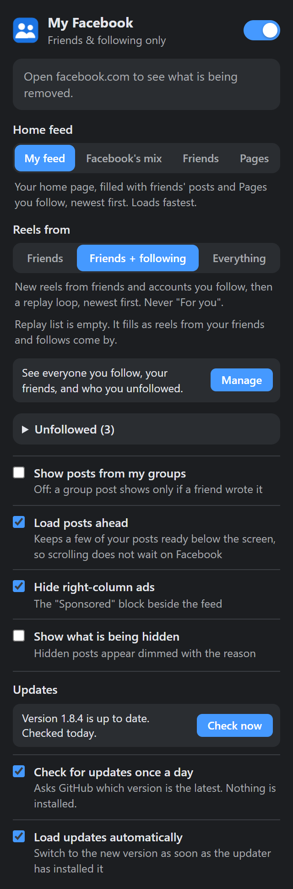
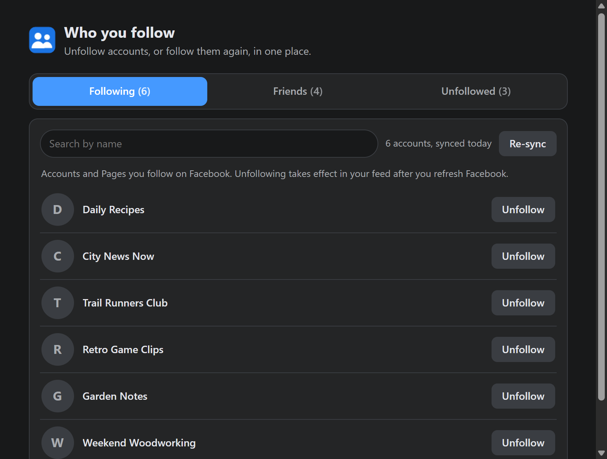
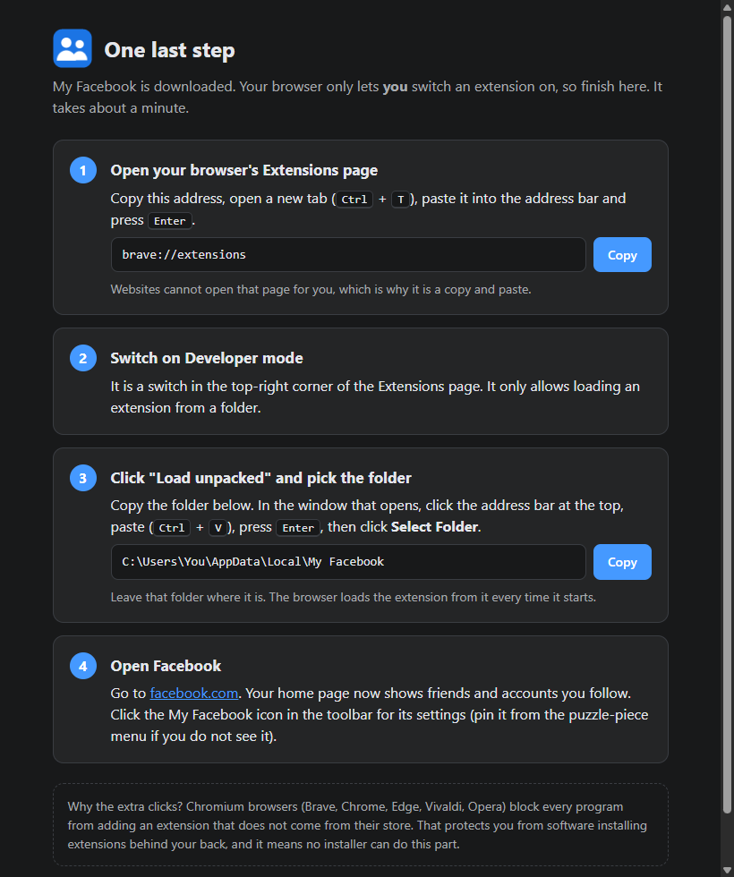
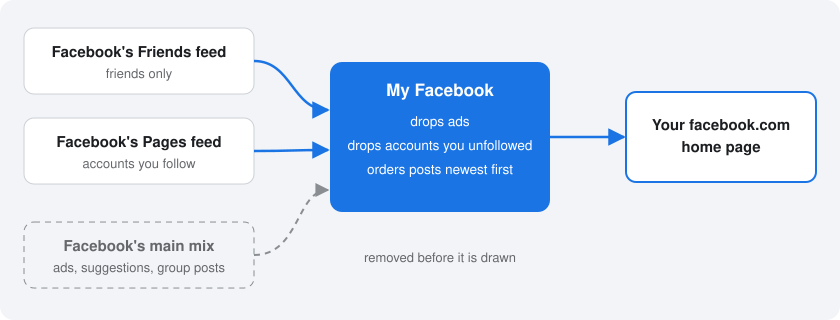

<h1 align="center">My Facebook</h1>

<p align="center"><b>Your Facebook home page, with only the people you chose to see.</b><br>
A free browser extension for Brave, Chrome, Edge and other Chromium browsers.</p>

<p align="center">
  <a href="https://github.com/skyehosting/my-facebook-extension/releases/latest/download/Install-My-Facebook.bat"><b>Download the installer for Windows</b></a>
  &nbsp;·&nbsp;
  <a href="#install-by-hand">Install by hand (any computer)</a>
  &nbsp;·&nbsp;
  <a href="#how-it-works">How it works</a>
</p>

---

Facebook's home feed is mostly things you never asked for: ads, "Suggested for you", posts from groups, reels from strangers. **My Facebook** removes all of that and fills your home page with posts from **your friends and the accounts you follow**, newest first.

| On facebook.com | Without My Facebook | With My Facebook |
| --- | --- | --- |
| **Home feed** | Ads, suggested posts, group posts, "People you may know", a Reels shelf | Only friends and accounts you follow |
| **Order** | Whatever Facebook's ranking decides | Newest first |
| **Reels** | Mostly "For you" reels from strangers | Reels from friends, or friends plus accounts you follow |
| **Who you follow** | A list on your profile, without unfollow buttons | One page with **Unfollow** and **Follow again** buttons |

<p align="center">
  
  &nbsp;&nbsp;
  
</p>
<p align="center"><sub>Left: the settings popup. Right: the "Who you follow" page. The names shown are made-up examples.</sub></p>

## Contents

- [What it does](#what-it-does)
- [Install](#install)
- [Using it](#using-it)
- [How it works](#how-it-works)
- [Privacy](#privacy)
- [Updating](#updating)
- [Questions](#questions)
- [For developers](#for-developers)

## What it does

- **Cleans your home feed.** Ads, suggested posts, the Reels shelf, "People you may know" and group suggestions are removed before they are drawn, so they never flash on screen.
- **Fills the page with your people.** The home page is filled from Facebook's own Friends feed and Pages feed, which contain only friends and accounts you follow. You keep the normal home page, with the post box and stories on top.
- **Keeps posts ready.** A few posts are always loaded below the screen, so scrolling does not stop to wait for Facebook.
- **Tames reels.** Choose whose reels you see: friends only, friends plus accounts you follow, or everything. When there is nothing new, reels you have already seen from those people replay in a loop, newest first.
- **Makes unfollowing easy.** Every post's "..." menu gets an **Unfollow** entry (and **Follow again** to undo it). A separate page lists everyone you follow, your friends, and everyone you unfollowed.
- **Tells you about updates.** It checks this page once a day and shows a small notice on facebook.com when a newer version exists.

## Install

### Windows: use the installer

1. **[Download Install-My-Facebook.bat](https://github.com/skyehosting/my-facebook-extension/releases/latest/download/Install-My-Facebook.bat)** (from the [latest release](https://github.com/skyehosting/my-facebook-extension/releases/latest)).
2. **Double-click it.** Windows may ask whether to run a file from the internet: choose **Run** (or **More info**, then **Run anyway**). The installer is a plain text script; you can open it in Notepad to read exactly what it does.
3. The installer downloads the extension to `%LOCALAPPDATA%\My Facebook`, finds your browser, and opens a short guide page in it.
4. **Follow the four steps on that page.** They take about a minute.

<p align="center"></p>

> **Why is there a last step by hand?**
> Chromium browsers block every program from adding an extension that does not come from their store, and from opening their Extensions page. That protects you from software installing extensions behind your back. It also means no installer can do the final two clicks for you, so this one does everything else and then walks you through them.

### Install by hand

Works on Windows, Mac and Linux.

1. Download the extension: **[Download ZIP](https://github.com/skyehosting/my-facebook-extension/archive/refs/heads/main.zip)**.
2. Unzip it somewhere it can stay, for example `Documents\My Facebook`. The browser loads the extension from this folder every time it starts, so do not move or delete it afterwards.
3. Open your browser's Extensions page: type `brave://extensions` (or `chrome://extensions`, `edge://extensions`) in the address bar.
4. Switch on **Developer mode** (top right).
5. Click **Load unpacked** and pick the unzipped folder, the one that contains `manifest.json`.
6. Open or refresh facebook.com.

## Using it

Click the **My Facebook** icon in the browser toolbar to open its settings. If you do not see the icon, open the puzzle-piece menu and pin it.

### The settings

| Setting | What it does |
| --- | --- |
| **On / off switch** (top right) | Turns the whole extension off and gives you Facebook exactly as it is. |
| **Home feed: My feed** | The default. Your home page shows friends and accounts you follow, newest first. |
| **Home feed: Facebook's mix** | Keeps Facebook's own ranked feed and removes everything that is not from a friend or an account you follow. Slower, because most of what Facebook sends gets removed. |
| **Home feed: Friends / Pages** | Opens Facebook's own Friends feed or Pages feed instead of the home page. |
| **Reels from** | **Friends**, **Friends + following**, or **Everything** (Facebook's normal reels). |
| **Manage** | Opens the "Who you follow" page. |
| **Show posts from my groups** | Off: a group post shows only when a friend wrote it. On: all posts from groups you joined are shown. |
| **Load posts ahead** | Keeps a few posts loaded below the screen. Turn it off if you want Facebook to load only as you scroll. |
| **Hide right-column ads** | Hides the "Sponsored" block beside the feed. |
| **Show what is being hidden** | Shows removed posts dimmed, with the reason, so you can check what the extension is doing. |
| **Updates** | Check for a new version now, and choose whether it checks once a day. |

The top of the popup shows how many posts were hidden and shown on the page you are looking at, and why.

### Unfollow from a post

Open the **...** menu on any post and choose **Unfollow**. The account is unfollowed on Facebook and hidden by My Facebook; its posts and reels are gone after you refresh the page. Changed your mind? Open the same menu and choose **Follow again**.

### The "Who you follow" page

Press **Manage** in the popup. The page has three tabs, each with a search box:

- **Following:** every account you follow. Press **Sync** once to load the list from Facebook.
- **Friends:** your friends. Unfollowing a friend keeps them as a friend and only hides their posts.
- **Unfollowed:** everyone you unfollowed, with **Follow again**.

Unfollowing here hides the account right away. The unfollow on Facebook itself is carried out by an open Facebook tab when Facebook makes that possible, and each row tells you whether it has happened yet.

### Friends-only reels

Pick **Friends** under "Reels from", then press **Sync** so the extension knows who your friends are. It opens your friends list in a new tab, reads it there, and tells you when it is done.

## How it works

You do not need any of this to use the extension. It is here for the curious.

**It reads what Facebook already told your browser.** When Facebook sends a post to your browser, it also sends what kind of post it is: an ad, a suggestion, a group post, and whether you follow the person who wrote it. My Facebook reads that information on the page and decides, before the post is drawn, whether it belongs to someone you chose to see.

**"My feed" asks Facebook for the right posts to begin with.** Facebook has two feeds of its own that contain only what you want: a Friends feed and a Pages feed. My Facebook asks for both, using the same kind of request the Facebook page itself makes when you scroll, and places their posts into your home page.

<p align="center"></p>

- **Order:** each feed is newest first, and the two are merged by time. At most three posts from Pages appear in a row, so a Page that posts all day cannot bury your friends.
- **Nothing jumps:** only the part of the feed that is not on screen yet is changed. Posts you are looking at never move.
- **No duplicates:** a post is recognised by its permanent id, so it is placed once.
- **Loading ahead:** while fewer than eight posts are waiting below the screen, the extension keeps the feed loading in the background.

## Privacy

- **Everything happens in your browser.** The extension has no server and no account. It does not collect, upload or share anything.
- **One outside request:** once a day it asks GitHub which version is the latest. You can turn that off in the popup.
- **What it stores, on your computer only:** your settings, the ids of your friends and followed accounts (with names and pictures for the "Who you follow" page), the list of accounts you unfollowed, a list of reels for the replay loop, and the technical settings of Facebook's own "load more posts" request.
- **What it asks for:** permission to run on facebook.com, to store its settings, and to set a timer for the daily update check. Nothing else.
- **Open source:** every line is in this repository.

My Facebook is not made, endorsed or supported by Meta or Facebook.

## Updating

When a newer version is published, a notice appears in the bottom-left corner of facebook.com and in the popup.

- **Windows:** double-click **Update My Facebook.bat** in the extension folder (or run the installer again). The extension switches to the new version by itself the next time you open or refresh Facebook.
- **Mac / Linux, or by hand:** download the ZIP again, unzip it over the same folder, then press the reload arrow on the extension's card on the Extensions page.

An extension that is loaded from a folder cannot replace its own files, which is why updating takes that one double-click.

## Questions

<details>
<summary><b>A post I wanted to see is missing.</b></summary>

Turn on **Show what is being hidden** in the popup and refresh. Removed posts appear dimmed with the reason. The usual causes: it is a group post (turn on **Show posts from my groups**), or the account is on your **Unfollowed** list (open **Manage** and press **Follow again**).
</details>

<details>
<summary><b>Something I do not want is showing up.</b></summary>

Facebook changes its site often, and when it does, the extension may need an update. Check the popup for a newer version. If you are up to date, please open an issue on this page and say what you saw.
</details>

<details>
<summary><b>Does it work on my phone, or in Firefox or Safari?</b></summary>

No. It works in Chromium-based browsers on a computer (Brave, Chrome, Edge, Vivaldi, Opera). It does not change the Facebook mobile app.
</details>

<details>
<summary><b>My browser warns about "developer mode extensions".</b></summary>

Some browsers show a reminder at startup when an extension was loaded from a folder instead of their store. It is expected; you can dismiss it.
</details>

<details>
<summary><b>My Facebook is not in English.</b></summary>

The main features do not depend on language. A few fallbacks, and the reel viewer's Next and Previous buttons, are recognised by their English labels, so some parts may work less well in other languages.
</details>

<details>
<summary><b>How do I remove it?</b></summary>

Open your browser's Extensions page and press **Remove** on the My Facebook card, then delete the folder. Accounts you unfollowed on Facebook stay unfollowed; follow them again first if you want them back.
</details>

## For developers

<details>
<summary>Working on the extension</summary>

```
git clone https://github.com/skyehosting/my-facebook-extension.git
```

Load the cloned folder with **Load unpacked**. After changing files, press the reload arrow on the extension's card and refresh Facebook. In a git checkout, `Update My Facebook.bat` runs `git pull` instead of downloading a ZIP.

**Publishing a version:** raise `"version"` in `manifest.json` and push to `main`. Everyone's daily check compares their version with that file. The installer always downloads the current `main`, so the release does not need a new upload for every version.

| File | What it does |
| --- | --- |
| `manifest.json` | Extension definition and version number |
| `src/main.js` | Runs inside facebook.com: feed filter, "My feed", loading ahead, reels, post menu entry |
| `src/bridge.js` | Passes settings and saved lists between the page and the extension; shows the update notice |
| `src/background.js` | Daily update check; loads a new version once it is on disk |
| `src/style.css` | Styles for hidden posts and the extension's notices |
| `popup/` | The settings popup |
| `manage/` | The "Who you follow" page |
| `tools/Install-My-Facebook.bat` | The Windows installer (also attached to each release) |
| `tools/install-guide.html` | The guide page the installer opens |
| `tools/update.ps1` | The updater that `Update My Facebook.bat` runs |
| `docs/` | Screenshots used on this page |

</details>
